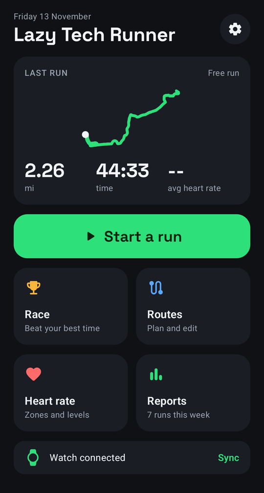
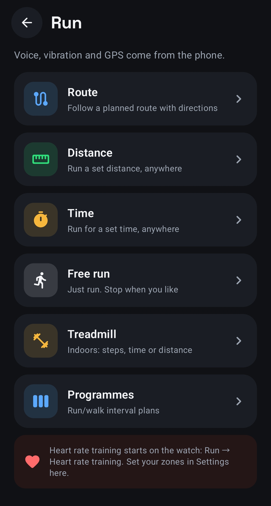
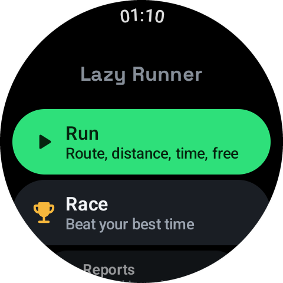

# Lazy Tech Runner

A free app for your Android phone and Wear OS watch that gets you off the sofa and moving.
Walk, jog or run: it talks you through it, shows you the way, and keeps a record of what you did.

It is a hobby project by [Lazy Tech Geek](https://www.youtube.com/@LazyTechGeek). It is not a professional
training app. Think of it as a friendly nudge, in the spirit of Couch to 5K.

The app is free. If it gets you moving and you'd like to say thanks, you can [buy me a coffee ☕](https://buymeacoffee.com/lazytechgeek).

  
  &nbsp;&nbsp;
  
  &nbsp;&nbsp;
  

## What it does

- **Just go.** Free run, a set distance, a set time, or a treadmill session counted in steps.
- **Follow a route.** Plan one on the phone's map, then get spoken turn directions and a live map on your wrist.
- **Run/walk programmes.** A nine-week beginner plan is built in, and you can make your own.
- **Race yourself.** Beat your best time on a route, or chase a steady pacer.
- **A real voice.** Pre-recorded prompts that talk over your music: turns, distance to go, halfway, well done.
- **Maps that work without signal.** Save map areas to the watch before you leave.
- **Reports.** Weekly and monthly totals, steps, calories, and whether each outing was a walk, jog or run.
- **Phone, watch, or both.** The phone app works on its own. The watch works on its own once set up.

## What you need

| | |
|---|---|
| Phone | Android 8 or newer |
| Watch (optional) | Wear OS 3 or newer. Built and tested on a Samsung Galaxy Watch 6 with a Samsung S23+. Other watches should work but are untested |
| Cost | Free |

It is not on the Play Store. You install it from the files on this page, which takes a few minutes the first time.
After that, the app updates itself.

## Download

Tap a link to download the newest version straight away:

- 📱 **[LazyTechRunner-phone.apk](https://github.com/LazyTechGeek/LazyTechRunner/releases/latest/download/LazyTechRunner-phone.apk)** goes on your phone.
- ⌚ **[LazyTechRunner-watch.apk](https://github.com/LazyTechGeek/LazyTechRunner/releases/latest/download/LazyTechRunner-watch.apk)** goes on your watch.

> **Before you install.** This app isn't in the Play Store, so Android treats it as coming from an unknown source.
> - **Phone:** Android asks you to allow your browser to install apps, and Play Protect may show a warning. Both are normal for apps from outside the store. You don't need developer mode on the phone.
> - **Watch:** you need to switch on developer mode and wireless debugging, then send the app from a computer. You only do this once.
>
> The [install guide](docs/install.md) takes you through both, one step at a time. Only download the app from this page.

Older versions, and notes on what changed in each one, are on the [Releases page](https://github.com/LazyTechGeek/LazyTechRunner/releases).

## Guides

1. **[Installing](docs/install.md)**: phone first, then the watch.
2. **[Phone app guide](docs/phone-guide.md)**: planning routes, starting a run, reports and settings.
3. **[Watch app guide](docs/watch-guide.md)**: running with the watch, map views and offline maps.
4. **[Voice prompts](docs/voice.md)**: what it says and when.
5. **[Questions and fixes](docs/faq.md)**: the things most likely to trip you up.

## Your data

Your runs, routes and profile stay on your phone and watch. There is no account and nothing is uploaded.
The app uses the internet only to draw maps, look up place names, snap planned routes to roads,
and check this page for updates.

## Terms

Free for personal use, with no warranty. Please don't re-upload it or sell it. The full wording is in [LICENSE](LICENSE).

This app is not medical or training advice. If you're unsure whether exercise is safe for you, check with a doctor first.

## Support the developer

Lazy Tech Runner is free and always will be. It takes a lot of evenings to build, though, so if it's been useful:

- ☕ [Buy me a coffee](https://buymeacoffee.com/lazytechgeek)
- ▶️ Subscribe to [Lazy Tech Geek on YouTube](https://www.youtube.com/@LazyTechGeek)

## Credits

Maps © [OpenStreetMap](https://www.openstreetmap.org/copyright) contributors, with tiles from
[OpenFreeMap](https://openfreemap.org) and [OpenMapTiles](https://openmaptiles.org), drawn with [MapLibre](https://maplibre.org).
Route snapping uses the FOSSGIS routing server (OSRM). Place names come from Nominatim.
