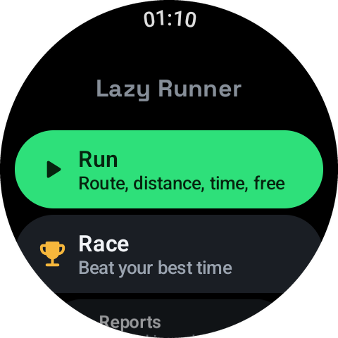

# Watch app guide

Once the watch has your routes and programmes, you can leave the phone at home.

> **Which watch?** Lazy Tech Runner was built and tested on a Samsung Galaxy Watch 6. It should run on other Wear OS 3 or newer watches, but those haven't been tested. The watch's own settings menus are described as Samsung shows them, so names and places may differ on a Pixel Watch or another make. Nothing in the app needs a bezel: every action has an on-screen button.

## Home

The watch opens to four choices: **Run**, **Race**, **Reports** and **Settings**.

## Starting a run

Tap **Run** and choose:

| Choice | What it does |
|---|---|
| **Route** | A saved route, with spoken directions and a map |
| **Distance** | A set distance, anywhere |
| **Time** | A set time, anywhere |
| **Free run** | Just go. Stop when you like |
| **Treadmill** | Indoors: steps, time, distance or free |
| **Heart rate training** | Pushes and recoveries guided by your heart rate |
| **Programmes** | Run/walk plans, Week 1 to 9 |

The **Ready** screen waits for GPS, then counts down and says "Go".

For sound, pair your earphones with the watch. The voice talks over music playing from the watch.

## During a run

- **Tap the screen** to show the controls. They hide again after a few seconds.
  - **Pause** and **Stop** at the bottom.
  - 🌙 / ☀️ switches night and day map colours.
  - The **view button** on the right edge moves to the next view.
- If your watch has a bezel or a crown, turning it changes the view too. On a touch bezel, slide your finger round the edge.

### Views on a route

1. **Map, flat**
2. **Map, tilted** (3D)
3. **Line only**: your route as a simple line, with no map
4. **Whole route**: the full outline, showing how far round you are

On distance, time and free runs there's just the map, flat or tilted.

The screen also shows up to three figures of your choice, such as heart rate, distance to go and speed. Choose them in **Settings → Screen and map → What's on the screen**.

If the map area hasn't been saved and there's no signal, the watch shows **No map here** and carries on with the line view. Directions still work.

### Turn directions

On a route the voice calls each turn a few seconds ahead, and the watch buzzes. The screen shows the next turn arrow and how far away it is.

## Finishing

Routes, distances and times finish by themselves. Otherwise tap the screen, then **Stop**, then **Finish and save**. The outing is saved to Reports and copied to the phone.

## Race

Pick **Route**, **Distance** or **Time**, then an opponent: your best, a pacer, or **Just run it**. The voice gives the gap as you go and tells you whether you won.

## Reports

This week's outings and totals. The phone app has the fuller reports.

## Settings

| Item | What's in it |
|---|---|
| **Voice** | Voice on or off, milestones, gentle bends, countdown ticks, turn timing check |
| **Screen and map** | Always on when running, run screen brightness, what's on the screen, map colours and detail, offline maps |
| **Run** | Miles or kilometres, countdown length, how often a GPS point is saved |
| **Heart rate** | Zones 1 to 5 |
| **Programmes and pacers** | View, edit and create |
| **Simulation** | Pretend runs for testing |
| **Help and about** | Version and where to find this guide |
| **Sync with phone** | Shows the last sync. Tap to sync now |
| **Check for updates** | Last in the list |

### Always on when running

With this on, the screen stays lit during a run at the brightness you choose (25, 50, 75 or 100%). With it off, the screen sleeps as normal and wakes when you raise your wrist. Brighter screens use more battery.

### Offline maps

**Settings → Screen and map → Offline maps** lists the areas saved on the watch, with the size and date of each. You can download an area again or remove it here. Adding new areas is easier from the phone.

## Battery tips

- Save offline maps at home on Wi-Fi, not during a run.
- Use a lower run screen brightness, or let the screen sleep.
- Switch off **Wireless debugging** after installing.
